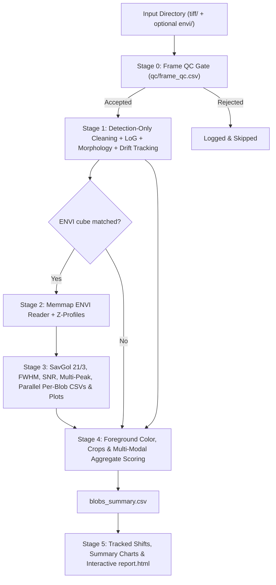
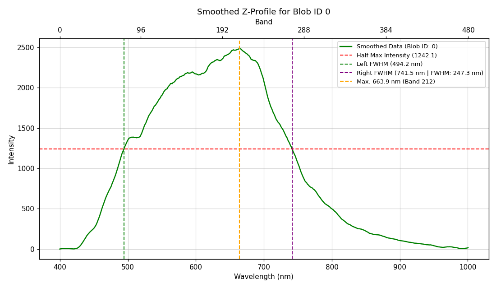
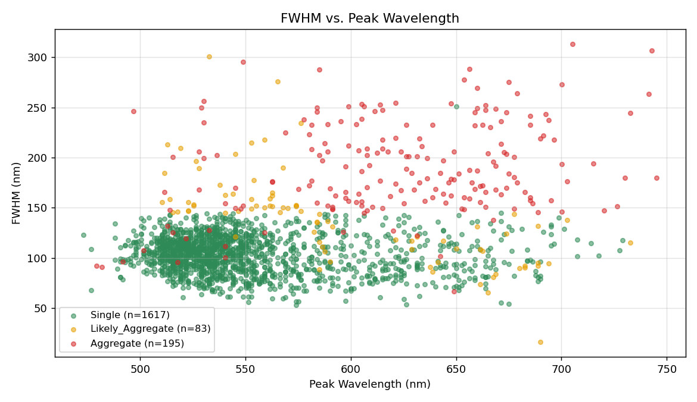

# darkfield-hsi

[](https://www.python.org/downloads/)
[](https://opensource.org/licenses/Apache-2.0)

Automated **dark-field hyperspectral imaging (HSI)** processing suite for plasmonic nanoparticle microscopy (e.g., CytoViva push-broom HSI). Combines TIFF frame quality control, push-broom artifact cleaning, drift-registered blob tracking, memory-mapped ENVI spectral extraction, Savitzky-Golay LSPR analysis, physics-driven multi-modal aggregate classification, and an offline interactive HTML workstation.

---

## Pipeline Overview



### Visual Outputs

| Dual-Axis Per-Blob Smoothed Spectrum (Wavelength nm + Band) | Multi-Modal Aggregate Separation (FWHM vs. Peak Wavelength) |
| :---: | :---: |
|  |  |

---

## Key Features

- **Stage 0 — Frame QC Gate (`qc.py`)**: Scores every TIFF on background median/MAD, high-frequency shot noise, vertical push-broom striping, SNR, and focus; logs results to `qc/frame_qc.csv` and rejects noisy frames automatically before detection.
- **Stage 1 — Detection-Only Cleaning, Morphology & Drift Tracking (`detection.py`)**: Pre-cleans an in-memory copy (`max_rgb` projection, column-median destriping, median/Gaussian denoising, background clipping) without touching original RGB TIFFs. Extracts local spot morphology (`Spot_Area_px`, `Spot_Radius_FWHM_px`, `Eccentricity`, `Is_Saturated`), registers stage drift via `phase_cross_correlation`, and performs 1-to-1 Hungarian tracking.
- **Stage 2 — Memory-Mapped ENVI Reader (`envi.py`)**: Brace-aware `.hdr` parser (handles multi-line CytoViva `description` and calibrated `wavelength` arrays) over read-only `np.memmap` (`bsq`/`bil`/`bip`), defaulting to center-pixel extraction with optional `fixed_disk` and `blob_disk` modes.
- **Stage 3 — Spectral Quality, Multi-Peak LSPR & Parallel Exports (`spectra.py`)**: Savitzky-Golay smoothing (`window=21, poly=3`), sub-band interpolated FWHM (bands + nm), `Spectral_SNR` / `Low_SNR`, multi-peak `find_peaks`, plus auto-parallelized per-blob spectrum CSVs (Origin/Excel/Python ready) and dual-axis smoothed PNG plots.
- **Stage 4 — Foreground-Masked Color & Physics-Driven Aggregate Classifier (`postprocess.py`, `aggregate.py`)**: Samples color strictly on foreground pixels (eliminating dark-background hue corruption), exports `64×64` `normal/` and crosshair `marked/` crops, and scores aggregates using spectral + morphological evidence with material presets (`agnp`, `aunp`, `custom`) and TIFF-only fallback.
- **Stage 5 — Tracked Shifts, Summary Figures & Offline HTML Workstation (`reporting.py`, `html_report.py`)**: Generates `tracking/tracked_shifts.csv`, population summary charts, and a standalone zero-server `reports/report.html` inspector.

For deeper technical details, see [docs/architecture.md](docs/architecture.md) and [docs/data_format.md](docs/data_format.md).

---

## Installation

Requires **Python 3.10+**.

```bash
# Editable install (recommended for development)
pip install -e .

# With optional dev/test tools
pip install -e ".[dev]"
```

> If installing inside an offline or pre-populated conda/pyenv environment where `setuptools` is already installed, use `pip install --no-build-isolation --no-deps -e .`.

---

## Expected Input Data Layout

Raw microscopy datasets are excluded from Git (`.gitignore`) and stored locally. Organize each experiment as:

```text
my_experiment/
├── tiff/
│   ├── sample_t0.tif
│   └── sample_t5min.tif
└── envi/                     # Optional (Stages 2–3 skipped gracefully if absent)
    ├── sample_t0             # Extensionless binary (or .raw/.img/.bil/.bsq/.bip/.dat)
    ├── sample_t0.hdr
    ├── sample_t5min
    └── sample_t5min.hdr
```

Co-located TIFF + ENVI files inside a single folder are also supported. See [docs/data_format.md](docs/data_format.md) for ENVI header details and full CSV column schemas.

---

## Usage

### CLI Quick Reference

```bash
# 1. Generate an editable YAML configuration file
darkfield-hsi init-config -o config.yaml

# 2. Dry-run Stage 0 frame QC to inspect noise/striping metrics before full processing
darkfield-hsi qc -i path/to/experiment -o outputs/qc_check -c config.yaml

# 3. Run the complete pipeline (Stages 0–5)
darkfield-hsi run -i path/to/experiment -o outputs/run_01 -c config.yaml

# 4. Run across multiple experiment subdirectories in batch mode
darkfield-hsi batch -i path/to/experiments_root -o outputs/batch_01 -c config.yaml

# 5. Regenerate reports/report.html + FOV PNGs on an existing run in ~2 seconds
darkfield-hsi report -i path/to/experiment -o outputs/run_01 -c config.yaml
```

Useful `run` / `batch` overrides: `--no-qc`, `--no-track`, `--no-plots`, `--no-per-blob-csv`, `--no-report`, `--workers N`.

#### Run Individual Stages Standalone

```bash
darkfield-hsi detect -i path/to/experiment -o outputs/run_01 -c config.yaml
darkfield-hsi extract-envi -i path/to/experiment --blobs outputs/run_01/blobs_detected.csv -o outputs/run_01 -c config.yaml
darkfield-hsi analyze-spectra --z-profiles outputs/run_01/z_profiles -o outputs/run_01 -c config.yaml
darkfield-hsi postprocess -i path/to/experiment --blobs outputs/run_01/blobs_detected.csv --spectra outputs/run_01/spectra/spectral_metrics.csv -o outputs/run_01 -c config.yaml
```

### Python API

```python
from pathlib import Path
from darkfield_hsi import load_config, run_pipeline, run_batch

cfg = load_config(Path("configs/default.yaml"))
summary_df = run_pipeline(Path("path/to/experiment"), Path("outputs/run_01"), cfg)
```

---

## Interactive HTML Workstation (`reports/report.html`)

Open `<output_dir>/reports/report.html` directly in any browser (works offline via `file://`, zero server required):

- **Linked Views**: Click any blob card, any particle on the **Interactive Dark-Field FOV Map**, or any dot on the **Interactive FWHM vs. Peak Scatter Plot** to open the **Full-Screen Blob Inspector**.
- **Full-Screen Inspector**: Large dual-axis smoothed spectrum, `1× / 2× / 3×` zoomed Normal & Marked crops, **FOV locator minimap**, full metrics & evidence tags, per-blob Notes, and direct spectrum CSV download link.
- **Review Persistence & Subset Exports**: Save labels & notes in browser `localStorage`, **Export / Import Labels CSV** to resume across machines, and **Export Filtered Blobs CSV** for the active filter subset.

| Shortcut (in Full-Screen Inspector) | Action |
| :---: | :--- |
| `←` / `→` (or on-screen arrows) | Step to previous / next blob in active filtered list |
| `1` / `2` / `3` | Label as **Single** / **Aggregate** / **Noise** (supports **Auto-Advance**) |
| `Esc` | Close modal (or blur active note input) |

---

## Output Directory Structure

```text
<output_dir>/
├── run_config.yaml                         # Snapshot of resolved YAML configuration
├── blobs_detected.csv                      # Stage 1 detection & spot morphology
├── blobs_summary.csv                       # Master merged table (all stages)
├── qc/
│   └── frame_qc.csv                        # Per-frame noise, striping, SNR & QC decisions
├── tracked_images/                         # Annotated dark-field frames
├── tracking/
│   ├── frame_drift.csv                     # Phase-correlation inter-frame stage drift
│   └── tracked_shifts.csv                  # Per-Blob_ID ΔPeak_nm, ΔFWHM_nm & transitions
├── z_profiles/                             # Wide Band_0..N CSVs + wavelengths CSVs
├── spectra/
│   ├── spectral_metrics.csv                # Peak, FWHM, SNR & multi-peak LSPR metrics
│   ├── per_blob_csv/<stem>/                # Per-blob full spectrum CSVs
│   └── plots/<stem>/                       # Per-blob dual-axis smoothed spectrum PNGs
├── postprocess/
│   ├── blobs_color_crops.csv               # Foreground-masked HSV color stats
│   ├── blobs_aggregate.csv                 # Multi-modal Aggregate_Score, Class & Evidence
│   └── snapshots_manifest.csv
├── crops/
│   ├── normal/                             # 64x64 centered RGB crops
│   └── marked/                             # 64x64 crops with split red crosshair
└── reports/
    ├── report.html                         # Standalone interactive inspection workstation
    ├── fov/                                # Browser-readable RGB FOV PNGs
    └── summary_plots/                      # Population distribution & scatter PNGs
```

---

## Repository Architecture

```text
.
├── .github/                  # CI workflow (Python 3.10–3.12) & issue/PR templates
├── configs/default.yaml      # Reference pipeline configuration
├── docs/                     # Architecture guide, data format specs & README assets
├── src/darkfield_hsi/        # Installable Python package (Stages 0–5 + CLI + HTML report)
├── tests/test_pipeline.py    # Self-contained CI tests + optional local real-data tests
├── .gitattributes            # LF normalization & binary rules
├── .gitignore                # Excludes caches, raw HSI/TIFF data, outputs & legacy archive
├── pyproject.toml            # PEP 621 package metadata & console entry point
└── README.md
```

---

## Running Tests

```bash
python3 -m unittest discover -s tests -v
# or with pytest:
pytest -v
```

Unit and synthetic end-to-end tests run completely self-contained (including in GitHub Actions CI without raw data). Local real-CytoViva integration tests automatically run whenever a local `test_data/` directory is present and skip cleanly otherwise.

---

## License

Apache License 2.0 — see `LICENSE` in the GitHub repository once published.
