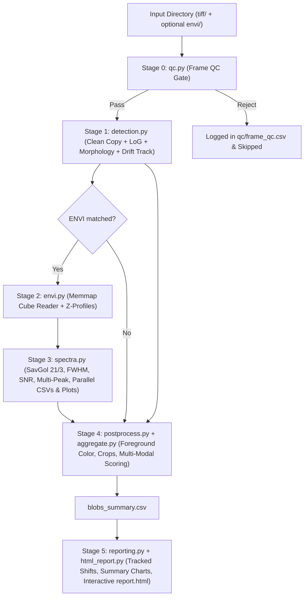

# Pipeline Architecture

`darkfield-hsi` processes dark-field hyperspectral imaging (HSI) acquisitions (such as CytoViva push-broom HSI microscopy) in six modular stages. Every stage reads/writes clean comma-separated CSVs and can be executed end-to-end (`darkfield-hsi run`) or standalone.

## Stage Overview

## Stage 0 — TIFF Frame Quality Control (`qc.py`)

Evaluates page 0 of each discovered TIFF on its `max_rgb` projection (`[0, 255]`):

- **`Bg_Median` / `Bg_MAD`**: Global background level and spread.
- **`HF_Noise_MAD`**: `median(|proj - median_filter_3x3(proj)|)` — isolates salt-and-pepper / shot noise independently of real nanoparticles.
- **`Stripe_Index`**: `std(column_medians) / max(Bg_MAD, 1.0)` — quantifies CytoViva vertical push-broom striping.
- **`SNR_P995`**: `(percentile(proj, 99.5) - Bg_Median) / max(Bg_MAD, 1.0)`.
- **`Laplacian_Focus`**: Variance of the 2D Laplacian (`float64`).

Frames failing configurable hard bounds (or dataset-relative modified Z-score outliers when `>= 3` frames are present) are logged in `qc/frame_qc.csv` and excluded from downstream detection without modifying original files.

## Stage 1 — Detection-Only Cleaning, Spot Morphology & Drift-Registered Tracking (`detection.py`)

Because the TIFF is used strictly for detection and visualization (never for spectral intensity), an in-memory copy is pre-cleaned before `blob_log`:

1. **Channel projection** (`max_rgb` default) prevents pure blue or red nanoparticles from being attenuated by standard grayscale luminance weights.
2. **Vertical push-broom destriping** subtracts each column's median intensity.
3. **Denoising & background floor clipping** (`3×3` median + Gaussian `σ = 0.7`, clipping `< med + 3 * MAD`) removes hot-pixel shot noise.

For each detected blob, local morphology is measured on the unblurred destriped patch (`±10 px`): `Spot_Peak_Intensity`, `Spot_Area_px`, `Spot_Radius_FWHM_px`, `Eccentricity` (intensity-weighted 2nd central moments of the connected component containing the peak), and `Is_Saturated`.

When `tracking.enabled` is `true`, inter-frame stage drift `(dy, dx)` is estimated via `skimage.registration.phase_cross_correlation` and applied only to the Hungarian matching distance matrix—stored `(X, Y)` coordinates remain exact per-frame pixel positions for ENVI extraction and crops.

## Stage 2 — ENVI Hyperspectral Reader (`envi.py`)

- Brace-aware `.hdr` parser cleanly handles multi-line `{ ... }` metadata blocks (e.g., CytoViva `description = { Date = ..., Exposure time = ... }` and `wavelength = { ... }`).
- Read-only `np.memmap` slices `BSQ`, `BIL`, and `BIP` cubes across ENVI dtypes (`uint8` through `float64`/`uint64`) with explicit endianness—zero full-cube RAM spikes.
- Default extraction mode is `pixel` (center pixel at `(X, Y)`), with optional `fixed_disk` and `blob_disk` modes.

## Stage 3 — Spectral Analysis & Parallel Exports (`spectra.py`)

- **Smoothing**: Savitzky-Golay filter (default `window=21, poly=3`).
- **Peak & FWHM**: Peak band/wavelength/intensity plus sub-band linearly interpolated left/right half-maximum crossings (`FWHM_Bands` and `FWHM_nm`) under configurable `zero` or `min` baseline.
- **Quality & Multi-Peak LSPR**: Robust high-frequency residual noise (`1.4826 * MAD(raw - smoothed)`), `Spectral_SNR`, `Low_SNR` flag, and secondary LSPR peak detection via `scipy.signal.find_peaks`.
- **Parallel Per-Blob Exports**: Chunked across CPU cores (`workers: auto`) to export full per-blob spectrum CSVs (`spectra/per_blob_csv/`) and dual-axis (`Wavelength nm` bottom + `Band` top) smoothed plots (`spectra/plots/`).

## Stage 4 — Foreground-Masked Color & Multi-Modal Aggregate Scoring (`postprocess.py`, `aggregate.py`)

- **Foreground-masked color**: Computes RGB/HSV statistics strictly on foreground pixels above the surrounding annulus background, eliminating dark-background noise hue corruption while exporting untouched `64×64` `crops/normal/` and red split-crosshair `crops/marked/` PNGs.
- **Multi-Modal Aggregate Classifier**: Combines spectral and morphological/optical evidence using material presets (`agnp`: `red_shift=580 nm`, `broad_fwhm=145 nm`; `aunp`: `620 nm`, `140 nm`; or `custom`) and exposure-invariant frame-relative ratios:

| Modality | Evidence Tag | Condition | Weight |
| :--- | :--- | :--- | :---: |
| Spectral | `BroadFWHM` | `FWHM_nm >= broad_fwhm_nm` | `0.30` |
| Spectral | `RedShifted` | `Max_Wavelength_nm >= red_shift_nm` | `0.25` |
| Spectral | `MultiPeak` | `Num_Peaks >= 2` | `0.25` |
| Spectral | `HighIntensity` | `Max_Intensity >= 3.0 × frame_median` | `0.20` |
| Morphological | `LargeSpot` | `Spot_Area_px >= max(12, 2.5 × frame_median)` | `0.30` |
| Morphological | `Elongated` | `Spot_Area_px >= 9` and `Eccentricity >= 0.65` | `0.25` |
| Optical Core | `BroadbandCore` | Bright white or yellow foreground core | `0.20` |
| Spatial (opt.) | `Proximity` | Neighbor within `1.2 × (r_i + r_j)` (off by default) | `0.20` |

Scores are capped to `[0, 1]` (re-normalized to morphological weights automatically in TIFF-only mode) and mapped to:
- `Single` (`score < 0.30`)
- `Likely_Aggregate` (`0.30 <= score < 0.55`)
- `Aggregate` (`score >= 0.55`)

## Stage 5 — Tracked Shifts, Summary Plots & Interactive HTML Workstation (`reporting.py`, `html_report.py`)

- Computes `tracking/tracked_shifts.csv` across multi-frame runs (`Delta_Peak_nm`, `Delta_FWHM_nm`, `Delta_Intensity`, displacement, class/color transitions).
- Generates static publication summary PNGs (`reports/summary_plots/`) and exports browser-readable RGB FOV PNGs (`reports/fov/`).
- Builds a zero-server, offline interactive workstation (`reports/report.html`) linking a clickable Dark-Field FOV Map, clickable FWHM vs. Peak scatter plot, paginated gallery, and Full-Screen Blob Inspector modal with keyboard navigation and CSV review import/export.
